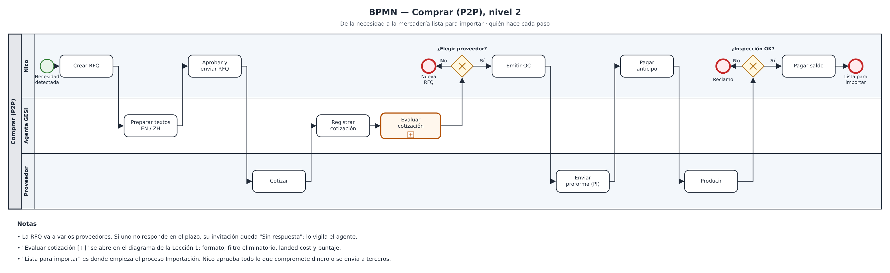

# Diseño del módulo Comprar (P2P)

Estado: **borrador, esperando aprobación de Nico.** Es el núcleo del módulo: no se programa hasta aprobarlo.

## El proceso

## Los datos

## Las etapas

## Preguntas abiertas

1. **Pedidos mixtos:** una Compra, ¿puede tener varios productos? (por ejemplo, tubos y accesorios de Lvzhou en el mismo contenedor). Si es así, la Compra lleva líneas de producto en vez de un solo producto.
2. **Muestras y certificación:** con un proveedor nuevo, ¿hay pasos de muestra y certificación (ISO, Bureau Veritas) antes de la OC?
3. **Inspección:** ¿la haces tú, el proveedor con fotos, o un tercero (SGS)?
4. **Pagos:** ¿siempre anticipo y saldo? ¿Hay otras formas, como carta de crédito para las lámparas GW3?
5. **Formato de la RFQ:** ¿qué datos pides siempre a los proveedores?
