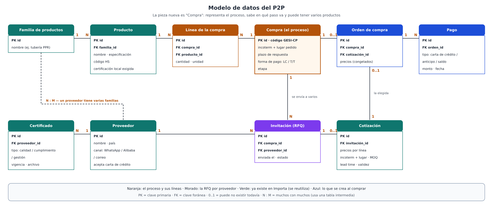
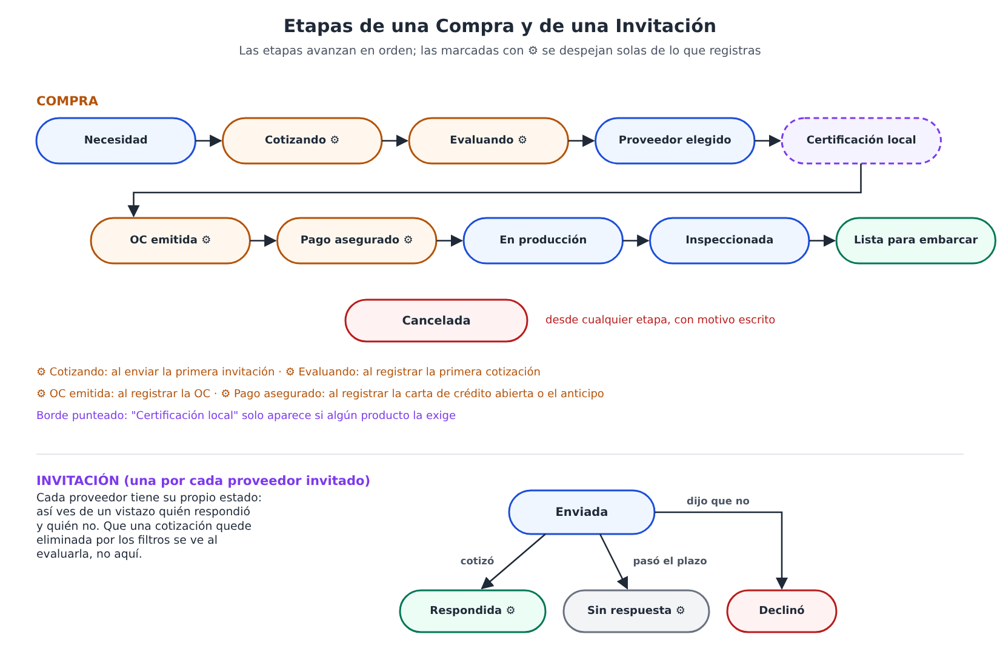

# Diseño del módulo Comprar (P2P)

Estado: **borrador v2, esperando aprobación de Nico.** Es el núcleo del módulo: no se programa hasta aprobarlo.

## El proceso

## Los datos

## Las etapas

## Reglas de negocio (respuestas de Nico, 23-11-2026)

1. **Una Compra tiene varios productos.** Los proveedores trabajan por familias de productos;
   una RFQ se envía a los proveedores de la familia.
2. **Certificados:**
   - Sin certificados pertinentes a lo que ofrece → **eliminado** (filtro).
   - Cada tipo de certificado suma puntaje: **calidad**, **cumplimiento** y **gestión**.
     Más tipos, más puntaje.
   - Aparte, el producto puede exigir **certificación local** en Chile. Si la exige, hay un
     paso de certificación con muestra antes de la OC.
3. **Inspección:** la hace una agencia contratada (no necesariamente SGS). Se limita a
   inspección de calidad general.
4. **Pago:** **carta de crédito obligatoria en los primeros embarques.** Si el proveedor no
   acepta carta de crédito → **eliminado** (filtro). En embarques siguientes, anticipo y saldo por T/T.
5. **Idiomas:** las RFQ se generan en **inglés** (para el proveedor) y **español** (para Nico).
   Nunca en idiomas que Nico no domina.

## Formato estándar de la RFQ

**Encabezado**
- GESI SpA: razón social, RUT, dirección, contacto (nombre, correo, WhatsApp)
- Código GESI-RFQ, fecha y plazo de respuesta

**Lo que se pide**
- Cada producto: descripción, especificación o norma, cantidad y unidad
- Incoterm y lugar (por defecto FOB del puerto de carga más cercano a la fábrica)
- Destino final (San Antonio o Punta Arenas)

**Lo que el proveedor debe incluir en su respuesta**
1. Precio unitario por producto, con moneda
2. Incoterm y puerto de carga
3. MOQ y plazo de producción (lead time)
4. Validez de la oferta
5. Aceptación de carta de crédito para el primer embarque
6. Certificados de calidad, cumplimiento y gestión (adjuntos)
7. Certificado de origen del tratado comercial con Chile
8. Embalaje: medidas y peso por bulto, y cuánto cabe en un contenedor de 20' y 40'
9. Garantía
10. Muestras: disponibilidad y costo

## Lo que se reutiliza

- De Importa: cálculos de landed cost, incoterms y aranceles, con sus pruebas.
- Del módulo RFQ que se construyó en Importa (`src/lib/pedido-cotizacion.ts`): el armado del
  texto en inglés, la traducción de unidades y la validación de líneas, con sus pruebas.
