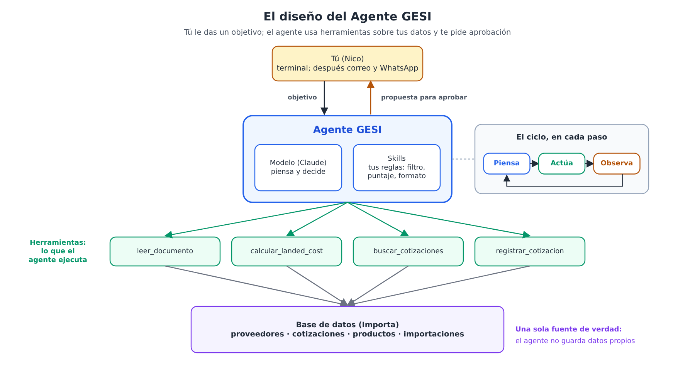

# Lección 0 — Qué es un agente

## La idea en una frase

Un **agente** es un modelo de IA que, en lugar de solo responder, **persigue un objetivo usando herramientas**,
mira el resultado de cada paso y decide el siguiente, hasta terminar o necesitar que intervengas.

## La analogía: tu asistente de importaciones

Imagina que contratas a un asistente para GESI. Para que trabaje bien necesita cinco cosas,
y un agente de IA necesita exactamente las mismas:

| Asistente humano | Pieza del agente | En el Agente GESI |
|---|---|---|
| Su cabeza: entiende, razona, decide | **Modelo** (Claude) | Entiende una cotización en inglés con unidades raras |
| El manual de la empresa | **Instrucciones del sistema y skills** | Filtro eliminatorio, puntaje, formato de solicitud |
| Su escritorio: calculadora, correo, carpetas | **Herramientas** | Calcular landed cost, guardar cotización, buscar proveedor |
| El archivador de la empresa | **Datos / memoria** | Base con proveedores, cotizaciones, importaciones |
| Su forma de trabajar: hacer, revisar, corregir | **El ciclo del agente** | Pensar → usar herramienta → ver resultado → repetir |

Y una sexta, que es tu rol: **el jefe que aprueba**. El agente prepara, tú decides.

## El ciclo, paso a paso

Le dices: *"Llegó la cotización de Lvzhou, compárala con las otras."*

| Paso | Qué hace el agente |
|---|---|
| 1. Piensa | "Necesito leer la cotización y traer las anteriores." |
| 2. Actúa | Usa `leer_documento(cotizacion_lvzhou.pdf)` |
| 3. Observa | Obtiene precio FOB, MOQ, plazo, incoterm |
| 4. Piensa | "Falta el landed cost para compararlas en igualdad." |
| 5. Actúa | Usa `calcular_landed_cost(...)` |
| 6. Observa | Obtiene el costo puesto en bodega |
| 7. Actúa | Usa `buscar_cotizaciones(producto="tubería preaislada")` |
| 8. Piensa | "Tengo todo. Aplico filtro y puntaje." |
| 9. Responde | Tabla comparativa + recomendación → **tú apruebas** |

Nadie le dijo el orden de los pasos: **el modelo los decide**. Eso es lo que lo hace un agente
y no un programa tradicional, donde cada paso está escrito de antemano.

### Qué significa cada paso

- **Piensa:** decide el siguiente paso según el objetivo y lo que ya sabe.
- **Actúa:** usa una herramienta (leer un documento, calcular, buscar en la base).
- **Observa:** lee el **resultado** de esa herramienta, incluidos los errores y los datos que faltan,
  y lo suma a lo que sabe. Es lo que le permite decidir el paso siguiente.

**La regla de escritura:** cada *actúa* usa **una sola herramienta**, y después de cada *actúa*
viene un *observa*. Así se escribe el ciclo cuando diseñes un agente:

| Paso | Ejemplo con un correo de un cliente |
|---|---|
| Piensa | "Tengo que saber quién es el cliente." |
| Actúa | `buscar_cliente(nombre="Salmonera Fiordo Austral")` |
| Observa | Lo encontré, pero no tiene RUT registrado. |
| Piensa | "Sigo, pero anoto que falta el RUT. Ahora necesito qué pide." |
| Actúa | `leer_documento(correo)` |
| Observa | Pide 300 m, entrega en Puerto Natales, para marzo. **No dice el diámetro.** |
| Piensa | "Sin diámetro no puedo cotizar. Hay que preguntarlo." |
| Responde | Te propone un borrador de respuesta pidiendo el diámetro → **tú apruebas** |

Si el agente no observara, trabajaría a ciegas: no sabría si la herramienta funcionó, no notaría que la
cotización viene sin incoterm o que el MOQ cambió, y no podría corregir el rumbo. Seguiría un plan
fijo, como una macro.

### Herramientas y skills no son lo mismo

- Una **herramienta** es algo que el agente **ejecuta**: `leer_documento`, `calcular_landed_cost`.
- Una **skill** es conocimiento que el agente **carga**: por ejemplo, cómo aplica GESI su filtro eliminatorio.
  No hace nada por sí sola; le dice al agente cómo usar las herramientas.

## Agente vs. lo que ya conoces

- **Claude en el chat:** solo tiene lo que le pegas y te devuelve texto. Tú haces el trabajo con esa respuesta.
- **Una automatización clásica (Zapier, macros):** pasos fijos. Si la cotización llega en otro formato, falla.
  *Zapier* es un servicio en internet que conecta aplicaciones con reglas del tipo "cuando pase X en una app,
  haz Y en otra"; por ejemplo, "cuando llegue un correo con adjunto, guárdalo en Drive". Es como una macro de
  Excel, pero entre aplicaciones: no razona ni se adapta.
- **Un agente:** decide los pasos, se adapta al formato y usa tus herramientas y tus datos.

## La lección de tu primera app

Tu app se desordenó porque eran muchas piezas que no conversaban entre sí. Es el error más común,
y el Agente GESI se diseña al revés desde el principio:

1. **Una sola base de datos** como fuente de verdad. Ninguna pieza guarda datos por su cuenta.
2. **Un solo cerebro** (el agente) que conoce todas las herramientas.
3. **Módulos que crecen de a uno:** primero cotizaciones; después Mercado Libre y el comercial de tubería.
   Cada uno funciona solo antes de sumar el siguiente.

## El diseño del Agente GESI

## Para pensar antes de la lección 1

Reúne estos materiales; los usaremos a lo largo del curso:

1. Dos o tres cotizaciones reales (PDF, Excel o capturas de WhatsApp).
2. Tu filtro eliminatorio: qué descarta a un proveedor de inmediato.
3. Tu puntaje: criterios y peso de cada uno.
4. Tu cálculo de landed cost (la planilla o la fórmula).
5. El formato con que pides cotizaciones.
