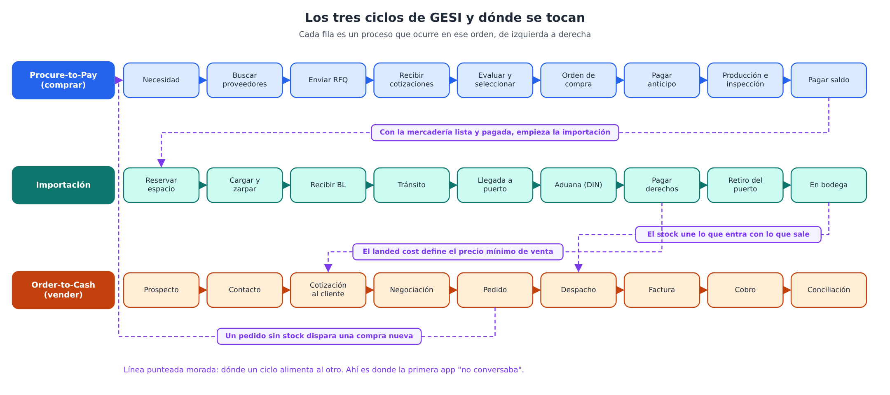
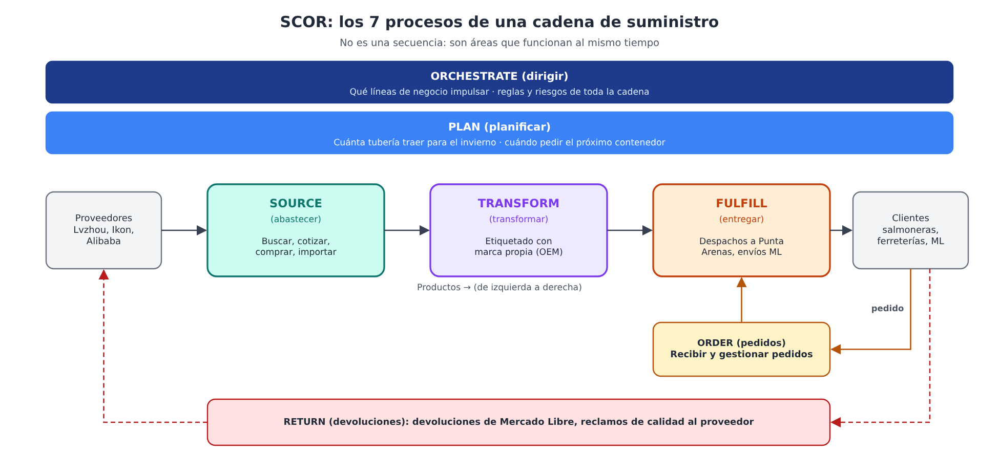
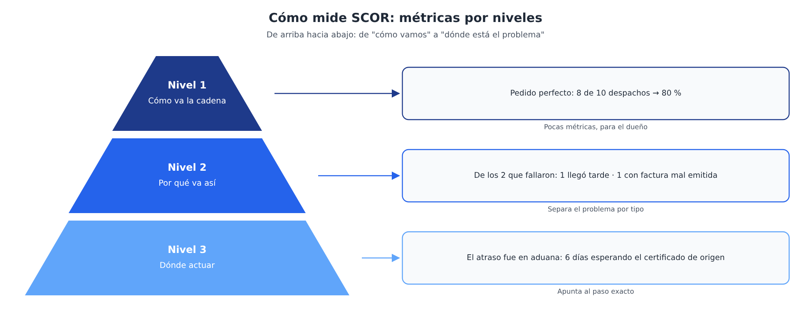
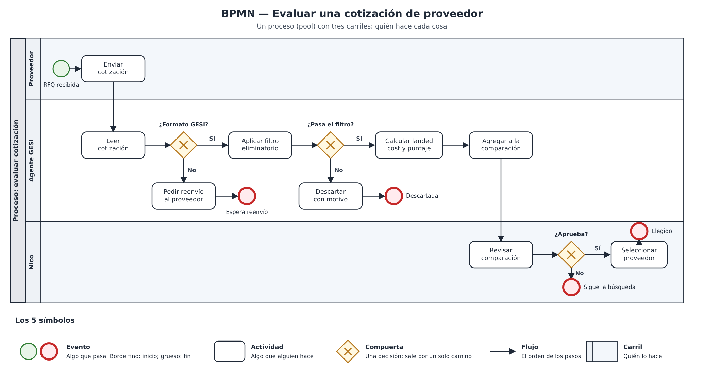
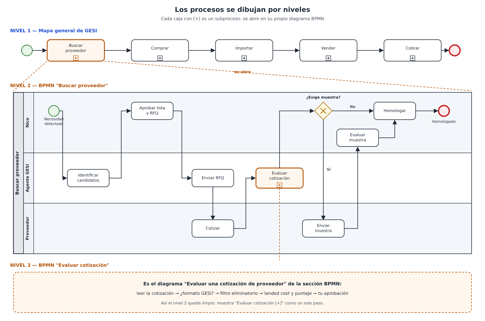
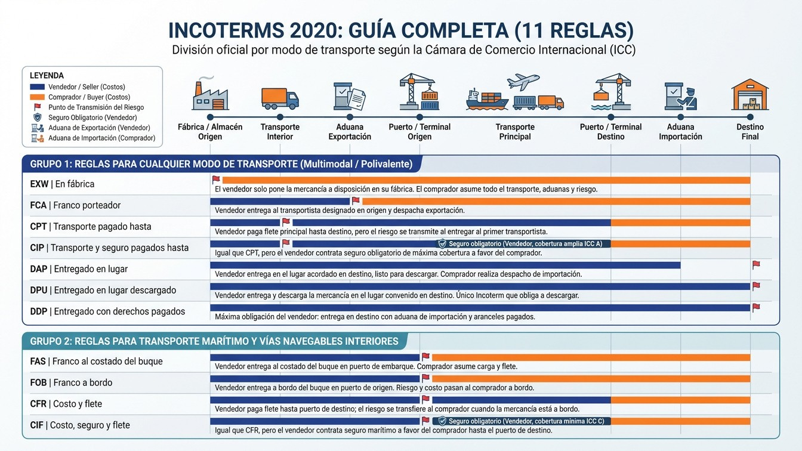
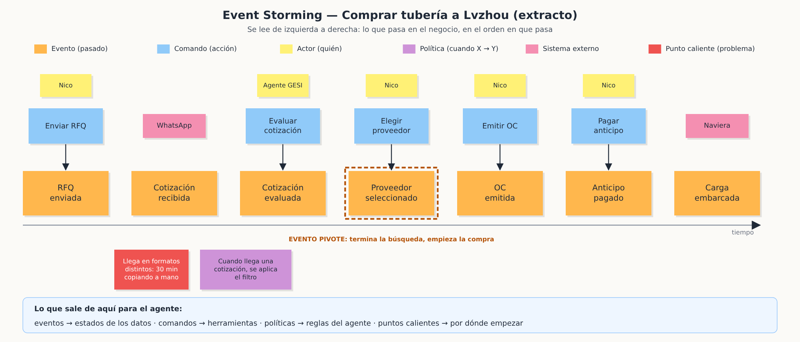

# Lección 1 — Mapa del negocio con estándares

## Por qué empezamos aquí

Tu primera app se desordenó porque se construyeron piezas sin un plano. En esta lección haremos
ese plano, pero sin inventarlo: usaremos los modelos que las empresas del mundo ya probaron.

Al terminar sabrás:

- Qué es un proceso de negocio y cuáles son los ciclos estándar.
- Cómo se ven los procesos de GESI dentro de esos ciclos.
- Qué son SCOR, BPMN e Incoterms, y para qué sirve cada uno en el agente.
- Cómo armar el mapa con la técnica Event Storming.
- Cómo medir tu punto de partida (línea base) y definir qué será un éxito.

### Cómo está organizada esta lección

Las 7 secciones **no son una cadena de eventos**: son temas que se apoyan uno en otro.

| Sección | Pregunta que responde |
|---|---|
| 1. Proceso de negocio | ¿Qué es un proceso? |
| 2. Los tres ciclos estándar | ¿Cuáles son los procesos de una empresa como GESI? |
| 3. SCOR | ¿Se me olvida algún proceso, y cómo mido si funcionan bien? |
| 4. BPMN | ¿Cómo dibujo un proceso para que cualquiera lo entienda? |
| 5. Incoterms | ¿Qué incluye el precio que me da un proveedor? |
| 6. Event Storming | ¿Cómo saco de mi cabeza cómo funciona mi negocio? |
| 7. Línea base | ¿Cuánto me cuesta hoy, para saber después si el agente sirve? |

Las listas numeradas de la sección 2 sí son secuencias: muestran el orden en que ocurren las cosas.

---

## 1. Qué es un proceso de negocio

Un **proceso** es una serie de actividades que parte con un disparador y termina con un resultado
que le importa a alguien.

- **Disparador:** "necesito tubería para la temporada de invierno".
- **Actividades:** buscar proveedores, pedir cotizaciones, comparar, negociar, comprar, importar.
- **Resultado:** tubería en bodega en Punta Arenas a un costo conocido.

La clave: un proceso **cruza áreas y herramientas**. La cotización llega por WhatsApp,
se compara en Excel, el pago sale del banco y el contenedor se sigue por correo con el forwarder.
Si cada herramienta guarda su propia versión, el proceso se rompe en cada cruce.
Eso es lo que le pasó a tu app.

---

## 2. Los tres ciclos estándar

Casi todas las empresas comerciales funcionan con los mismos ciclos. Los ERP del mundo
(SAP, Odoo, Oracle) están construidos alrededor de ellos. Tienen nombre en inglés porque así
se buscan en cualquier libro o curso.

Así se ven los tres ciclos de GESI y los puntos donde uno alimenta al otro:

El detalle de cada ciclo, paso a paso:

### 2.1 Procure-to-Pay (P2P): de la necesidad al pago al proveedor

1. Necesidad
2. Búsqueda de proveedores
3. Solicitud de cotización (RFQ)
4. Cotizaciones recibidas
5. Evaluación y selección
6. Negociación
7. Orden de compra (OC / PO)
8. Proforma invoice (PI) del proveedor
9. Pago de anticipo
10. Producción e inspección
11. Pago de saldo
12. Recepción de la mercadería
13. Factura y cierre

Términos estándar que conviene usar desde hoy:

| Término | Sigla | Qué es en GESI |
|---|---|---|
| Request for Quotation | RFQ | El mensaje en que pides precio a Lvzhou o a Ikon |
| Quotation | — | La respuesta con precios, MOQ, plazo e incoterm |
| Purchase Order | PO / OC | Tu compromiso de compra formal |
| Proforma Invoice | PI | El documento del proveedor que confirma el pedido y contra el que pagas |
| Minimum Order Quantity | MOQ | La cantidad mínima que acepta el proveedor |
| Lead time | — | Tiempo desde que pagas el anticipo hasta que la mercadería está lista |

Un control clásico de este ciclo es el **three-way match** (calce de tres vías): antes de pagar
el saldo se compara que **la OC, lo recibido y la factura** digan lo mismo. Si el proveedor
factura 1.000 m y embarcó 950, el calce lo detecta.

### 2.2 Ciclo de importación: del embarque a la bodega

En las empresas que importan, el P2P tiene un tramo propio:

1. Mercadería lista
2. Reserva de espacio (booking) con el forwarder
3. Carga y zarpe
4. Bill of Lading (BL): el título de la carga
5. Tránsito marítimo
6. Llegada a puerto chileno
7. Agente de aduana tramita la Declaración de Ingreso (DIN)
8. Pago de derechos e IVA
9. Retiro del puerto
10. Transporte a bodega (por ejemplo, a Punta Arenas)

De aquí sale el **landed cost**: el costo real del producto puesto en tu bodega, con todo incluido.
Es la única forma justa de comparar proveedores, porque un precio bajo en China puede terminar
siendo caro en Punta Arenas.

> Dato útil para Chile: el arancel general es 6 % sobre el valor CIF, pero Chile tiene tratados
> con China, Turquía, Vietnam y la Unión Europea (Polonia). Con certificado de origen el arancel
> puede bajar, muchas veces a 0 %. Hay que verificarlo por producto. El IVA de importación (19 %)
> en general es **crédito fiscal** para una empresa, así que normalmente no se suma al landed cost.
> Lo veremos con números en la lección 3.

### 2.3 Order-to-Cash (O2C): del interés del cliente al cobro

1. Prospecto
2. Contacto y calificación
3. Cotización al cliente
4. Negociación
5. Pedido / orden de compra del cliente
6. Despacho
7. Factura (documento tributario electrónico del SII)
8. Cobro
9. Conciliación del pago

En GESI tienes varias versiones de este ciclo:

- **Tubería preaislada:** salmoneras y ferreterías de Punta Arenas y Puerto Natales. Ciclo B2B clásico.
- **Lámparas GW3:** contratos anuales con Perú. O2C con un cliente extranjero, en el que además
  la mercadería viaja directo de China a Perú (triangulación), así que tu P2P y tu O2C se tocan
  en el mismo embarque.
- **Mercado Libre:** publicación → venta → despacho → liquidación de Mercado Libre (que te paga
  descontando comisión y envío).

### 2.4 Lo que une los ciclos

Los ciclos no están aislados:

- Una **venta** a una salmonera (O2C) puede disparar una **compra** a Lvzhou (P2P).
- El **landed cost** (importación) define el **precio mínimo** de venta (O2C).
- El **stock** une lo que entra (P2P) con lo que sale (O2C).

Estos puntos de unión son exactamente donde tu primera app "no conversaba".
En la lección 2 los convertiremos en relaciones explícitas.

---

## 3. SCOR: el modelo de referencia de la cadena de suministro

**SCOR** (Supply Chain Operations Reference) es mantenido por la asociación ASCM.
Su versión actual (SCOR Digital Standard) organiza una cadena de suministro en siete procesos:

| Proceso SCOR | Significa | En GESI |
|---|---|---|
| Orchestrate | Dirigir y coordinar la cadena | Tus decisiones de qué líneas de negocio impulsar |
| Plan | Planificar demanda y abastecimiento | Cuánta tubería traer para el invierno |
| Order | Recibir y gestionar pedidos de clientes | Pedidos de salmoneras, ventas en Mercado Libre |
| Source | Abastecerse de proveedores | Todo tu trabajo con Lvzhou, Ikon y Alibaba |
| Transform | Transformar o producir | Poco en GESI: etiquetado con marca propia (OEM) |
| Fulfill | Entregar al cliente | Despachos a Punta Arenas, envíos de Mercado Libre |
| Return | Devoluciones | Devoluciones de Mercado Libre, reclamos de calidad |

Estos 7 procesos **no van en orden**: son las grandes áreas de la cadena. Un mismo día puedes estar
cotizando (Source), despachando (Fulfill) y atendiendo una devolución (Return).

**Para qué te sirve:**

1. **Lista de chequeo:** si un proceso SCOR no aparece en tu mapa, probablemente lo estás haciendo
   "en la cabeza". Por ejemplo, ¿dónde está tu proceso de devoluciones?
2. **Métricas estándar:** ver abajo.

### Cómo define SCOR la forma de medir

SCOR no te dice "mide lo que te parezca". Trae un **diccionario de métricas** donde cada una tiene un
**nombre, una definición exacta y una fórmula**. Así, "pedido perfecto" significa lo mismo en GESI que
en cualquier empresa del mundo, y te puedes comparar con otras.

Las métricas están ordenadas en **niveles**:

- **Nivel 1 (estratégico):** pocas métricas que dicen *cómo va* la cadena.
- **Niveles 2 y 3 (diagnóstico):** métricas más finas que explican *por qué* va así.

Y se agrupan por **atributos de desempeño**: confiabilidad, capacidad de respuesta, agilidad,
costos y uso del capital (más sustentabilidad, en la versión actual).

Tres métricas de nivel 1 que le sirven a GESI desde ya, con números de ejemplo (ficticios):

| Métrica | Fórmula | Ejemplo GESI |
|---|---|---|
| **Pedido perfecto** (confiabilidad) | Pedidos perfectos ÷ pedidos totales × 100. Perfecto = completo, a tiempo, sin daños y con la documentación correcta | De 10 despachos a salmoneras, 8 fueron perfectos → **80 %**. El nivel 2 diría por qué fallaron los otros 2: ¿atraso o factura mal emitida? |
| **Tiempo de ciclo del pedido** (respuesta) | Días desde que el cliente pide hasta que recibe | Si hay stock en Punta Arenas: 3 días. Si hay que importar: 90 días |
| **Ciclo de caja** (capital) | Días desde que sale tu dinero hasta que vuelve | Pagas el anticipo el día 0, la mercadería llega el día 75, la vendes el día 100 y cobras a 30 días: **130 días** con el dinero inmovilizado |

El ciclo de caja es clave en importaciones: explica por qué un MOQ de 2 contenedores puede ser peor
negocio que un precio un poco más alto con MOQ de 1.

No necesitas certificarte en SCOR. Úsalo como checklist y como diccionario de métricas.

---

## 4. BPMN: la forma estándar de dibujar procesos

**BPMN 2.0** (Business Process Model and Notation) es un **estándar internacional**. Lo publica el
**OMG** (Object Management Group), un consorcio de empresas de tecnología, y también está adoptado
como norma **ISO/IEC 19510**.

**¿Quién define qué es un evento o una compuerta?** La especificación del estándar. Cada símbolo, su
forma y su significado están definidos de antemano: nadie los inventa. Por eso un consultor en Chile y
un programador en Alemania leen el mismo diagrama igual. El estándar tiene muchos símbolos más, pero con
estos cinco se dibuja casi cualquier proceso de GESI:

| Símbolo | Forma | Significa | Ejemplo GESI |
|---|---|---|---|
| Evento | Círculo (borde fino: inicio; grueso: fin) | Algo que pasa | "RFQ recibida" |
| Actividad | Rectángulo redondeado | Algo que alguien hace | "Calcular landed cost" |
| Compuerta | Rombo con una X | Una decisión: se sigue por un solo camino | "¿Pasa el filtro?" |
| Flujo | Flecha | El orden de los pasos | De una actividad a la siguiente |
| Carril | Franja con el nombre a la izquierda | Quién lo hace | Proveedor, Agente GESI, Nico |

Así se ve el proceso de evaluar una cotización dibujado en BPMN:

**Cómo leerlo:**

1. Empieza en el **círculo verde** del carril del proveedor: le llegó tu RFQ y envía su cotización.
2. La flecha baja al carril del **agente**, que lee la cotización.
3. En cada **rombo** el camino se divide: si la respuesta es "No", baja a una actividad que termina
   en un **círculo rojo** (fin). Si es "Sí", sigue a la derecha.
4. Al final, la flecha baja al carril de **Nico**: la decisión de elegir al proveedor es tuya.

Los **carriles** son lo más útil para el agente: dejan a la vista qué hace el agente solo y qué
tienes que aprobar tú.

### Un diagrama por proceso, por niveles

Cada proceso importante tiene su propio diagrama, y se dibujan **por niveles**, de lo general a lo
particular, como un mapa con zoom:

- **Nivel 1:** el mapa general de GESI, con los grandes procesos como cajas.
- **Nivel 2:** cada caja se abre en su propio BPMN, con carriles y decisiones.
- **Nivel 3:** el detalle de un paso complejo, solo cuando hace falta.

Las cajas que se abren llevan un **[+]**: en BPMN se llaman **subprocesos**.

**No todo proceso necesita diagrama.** Conviene dibujarlo si se repite seguido, si participan varios
actores, si ahí se pierde tiempo o hay errores, o si el agente va a participar en él. Para GESI, con
5 a 8 diagramas se cubre lo importante.

**El BPMN y la máquina de estados se complementan:** el diagrama "Buscar proveedor" dice *qué se hace*;
las etapas de homologación de Importa (Identificado → Contactado → Cotizado → Muestra → Homologado) dicen
*en qué etapa queda* cada proveedor. Lo verás en la Lección 2.

---

## 5. Incoterms 2020: las reglas del precio

Los **Incoterms** son reglas de la Cámara de Comercio Internacional (ICC). La versión vigente es 2020
y tiene **11 reglas**. Cada una responde tres preguntas:

1. **¿Quién paga cada tramo?** Transporte en origen, aduana de exportación, flete principal, seguro,
   gastos en destino, aduana de importación y aranceles.
2. **¿Dónde pasa el riesgo** al comprador? Desde ese punto, si la carga se daña o se pierde, el problema es tuyo.
3. **¿Quién hace los trámites** de aduana en cada país?

Ojo: **no definen** quién es dueño de la mercadería ni cómo se paga.

Esta guía muestra las 11 reglas de un vistazo. La barra azul es lo que paga el vendedor, la naranja lo
que paga el comprador, y la bandera 🚩 marca dónde el riesgo pasa al comprador:

### Las 11 reglas, una por una

**Para cualquier medio de transporte:**

| Regla | El vendedor entrega… | El riesgo pasa a ti… | Flete principal | Seguro |
|---|---|---|---|---|
| **EXW** En fábrica | En su fábrica, sin cargar | En su fábrica | Tú | Tú, si quieres |
| **FCA** Franco transportista | Al transportista que tú eliges, con la exportación tramitada | Al entregar al transportista | Tú | Tú, si quieres |
| **CPT** Transporte pagado hasta | Al primer transportista, pagando el flete a destino | **En origen**, al primer transportista | Vendedor | Tú, si quieres |
| **CIP** Transporte y seguro pagados | Igual que CPT, más seguro | **En origen** | Vendedor | Vendedor, cobertura **amplia** (ICC A) |
| **DAP** Entregado en lugar | En el lugar convenido en destino, sin descargar | En destino | Vendedor | Vendedor, si quiere |
| **DPU** Entregado y descargado | En el lugar convenido, descargado | En destino, tras descargar | Vendedor | Vendedor, si quiere |
| **DDP** Entregado, derechos pagados | En destino, con la importación y los impuestos pagados | En destino | Vendedor | Vendedor, si quiere |

**Solo para transporte marítimo:**

| Regla | El vendedor entrega… | El riesgo pasa a ti… | Flete principal | Seguro |
|---|---|---|---|---|
| **FAS** Franco al costado | Al costado del buque, en el puerto de origen | En el puerto de origen | Tú | Tú, si quieres |
| **FOB** Franco a bordo | Cargado a bordo del buque, en origen | Cuando la carga está a bordo | Tú | Tú, si quieres |
| **CFR** Costo y flete | A bordo, pagando el flete hasta el puerto de destino | **En origen**, a bordo | Vendedor | Tú, si quieres |
| **CIF** Costo, seguro y flete | Igual que CFR, más seguro | **En origen**, a bordo | Vendedor | Vendedor, cobertura **mínima** (ICC C) |

Fíjate en las reglas "C" (CPT, CIP, CFR, CIF): **el vendedor paga el flete, pero el riesgo es tuyo
desde el origen**. Si el contenedor se daña en alta mar, reclamas tú al seguro, aunque el flete lo haya
pagado el proveedor.

En la práctica con China se usan mucho FOB y CIF. Para contenedores, la ICC recomienda FCA, CPT o CIP,
porque el contenedor se entrega en el terminal antes de subir al buque.

### Lo que tienes que sumar para llegar a tu bodega

| Si te cotizan… | Te falta sumar |
|---|---|
| **EXW** | Carga en fábrica, transporte al puerto, aduana de exportación, flete, seguro, gastos en Chile, agente de aduana, arancel, transporte a bodega |
| **FCA** | Lo mismo que EXW, menos la carga y la aduana de exportación |
| **FOB** | Flete, seguro, gastos en Chile, agente de aduana, arancel, transporte a bodega |
| **CFR / CPT** | Seguro, gastos en Chile, agente de aduana, arancel, transporte a bodega |
| **CIF / CIP** | Gastos en Chile, agente de aduana, arancel, transporte a bodega |
| **DAP** | Descarga, agente de aduana, arancel (y transporte, si el lugar no es tu bodega) |
| **DDP** | Nada. Raro desde China: el vendedor necesitaría un importador en Chile |

### Un ejemplo: tres precios, ¿cuál es más barato? (ficticio)

Tres proveedores cotizan 1.000 m de tubería. Gastos en Chile, aduana y transporte a Punta Arenas:
US$ 3.850 en todos los casos. Arancel 0 % por el tratado con China.

| | A: EXW fábrica | B: FOB Ningbo | C: CIF San Antonio |
|---|---|---|---|
| Precio por metro | US$ 17,00 | US$ 18,50 | US$ 21,00 |
| Precio total | 17.000 | 18.500 | 21.000 |
| Transporte y aduana en China | 750 | — | — |
| Flete marítimo | 3.500 | 3.500 | — |
| Seguro | 120 | 120 | — |
| Gastos en Chile hasta bodega | 3.850 | 3.850 | 3.850 |
| **Landed cost total** | **25.220** | **25.970** | **24.850** |
| **Por metro** | **25,22** | **25,97** | **24,85** |

El precio más bajo (A, US$ 17) **no** es el más barato puesto en bodega. El más caro de lista (C) termina
siendo el más barato. Ojo con C: su seguro es de cobertura mínima, y el flete lo elige el proveedor.

### Por qué importa para el agente

Un precio sin incoterm y sin lugar **no se puede comparar**, como muestra el ejemplo. Por eso, en el
modelo de datos de GESI, un precio siempre se guardará como **monto + moneda + incoterm + lugar**.
Nunca solo el número. Es uno de los errores más comunes de los sistemas caseros, y el agente tiene que
evitarlo desde el diseño: si una cotización llega sin incoterm, la marca y lo pide, no lo supone.

---

## 6. Event Storming: cómo construir el mapa

**Event Storming** es una técnica creada por Alberto Brandolini. Se usa en talleres con notas
adhesivas de colores, pero funciona igual en papel o en el celular.

### Para qué sirve

Para **sacar de tu cabeza cómo funciona de verdad tu negocio** y ponerlo en una pared donde se vea
completo. Concretamente, sirve para cuatro cosas:

1. **Descubrir el proceso real, no el que crees que tienes.** Al ordenar los eventos aparecen pasos
   que haces de memoria y nunca anotaste ("ah, también le pido el certificado de origen").
2. **Encontrar dónde se pierde tiempo o se cometen errores.** Son los puntos calientes, en rojo.
3. **Ponerle nombre a cada cosa.** Si escribes "Cotización recibida", ya tienes el término para el
   glosario de la Lección 2.
4. **Obtener el plano del agente.** Cada pieza del mapa se convierte en una pieza del sistema
   (ver el recuadro azul del ejemplo de abajo).

**¿Por qué eventos y no actividades?** Porque un evento es un hecho que se puede comprobar: "la
cotización se recibió" es verdadero o falso. "Gestionar proveedores" en cambio es vago. Empezar por los
hechos evita discutir cómo se llama cada tarea.

Así se ve un tramo del mapa de la tubería de Lvzhou:

### Las piezas

| Color tradicional | Pieza | Cómo se escribe | Ejemplo |
|---|---|---|---|
| Naranja | **Evento** | En pasado, lo que ocurrió | "Cotización recibida" |
| Azul | **Comando** | Una orden o acción | "Solicitar cotización" |
| Amarillo | **Actor** | Quién da el comando | Nico, proveedor, agente |
| Lila | **Política** | "Cuando X, entonces Y" | "Cuando llega una cotización, se aplica el filtro" |
| Rosado | **Sistema externo** | Algo fuera de tu control | WhatsApp, Aduana, Mercado Libre |
| Rojo | **Punto caliente** | Un problema o una duda | "Aquí pierdo 30 minutos copiando datos" |

### Los pasos

1. **Lluvia de eventos.** Anota todos los eventos de tu negocio que se te ocurran, sin orden.
   Solo eventos, en pasado. Apunta a 30 o más.
2. **Línea de tiempo.** Ordénalos de izquierda a derecha según cuándo ocurren.
3. **Eventos pivote.** Marca los que cambian de etapa. Por ejemplo, "OC emitida" separa
   la búsqueda de la compra, y "Mercadería internada" separa la importación de la venta.
4. **Comandos y actores.** Antes de cada evento, anota qué acción lo causa y quién la hace.
5. **Políticas.** Anota las reglas automáticas. Muchas serán tareas del agente.
6. **Puntos calientes.** Marca en rojo donde se te va el tiempo o donde hay errores.
   **Ahí está el valor del agente.**

### Ejemplo con la tubería de Lvzhou

| # | Evento | Notas |
|---|---|---|
| 1 | Necesidad de tubería detectada | |
| 2 | Proveedores candidatos identificados | |
| 3 | RFQ enviada | Comando: Nico envía RFQ |
| 4 | Cotización recibida | Política: aplicar filtro. 🔴 Llega en formato distinto, hay que pasarla a mano |
| 5 | Cotización evaluada | |
| 6 | Proveedor seleccionado | ⭐ Evento pivote |
| 7 | OC emitida | |
| 8 | PI recibida | |
| 9 | Anticipo pagado | |
| 10 | Producción terminada | |
| 11 | Inspección aprobada | |
| 12 | Saldo pagado | |
| 13 | Carga embarcada | Sistema externo: naviera |
| 14 | BL recibido | |
| 15 | Carga arribada | |
| 16 | DIN aceptada | Sistema externo: Aduana |
| 17 | Mercadería internada | ⭐ Evento pivote |
| 18 | Mercadería en bodega | |

**Conexión con el agente:** los **eventos** serán los cambios de estado de tus datos (lección 2),
las **políticas** serán reglas del agente y los **puntos calientes** serán su lista de prioridades.

---

## 7. Línea base y criterios de éxito

Antes de construir algo para ahorrar tiempo hay que saber **cuánto tiempo toma hoy**.
Si no, nunca sabrás si el agente sirve.

### La línea base

Durante una semana normal, anota para cada tarea repetitiva:

| Tarea | Veces por semana | Minutos cada vez | Errores o retrabajos | Comentario |
|---|---|---|---|---|
| Redactar RFQ | | | | |
| Responder mensajes de proveedores | | | | |
| Pasar cotizaciones a la matriz | | | | |
| Calcular landed cost | | | | |
| Revisar Mercado Libre | | | | |
| Seguimiento a prospectos | | | | |

No tiene que ser perfecto. Una estimación honesta anotada en el momento vale más
que un recuerdo al final de la semana.

### Criterios de éxito

Un buen criterio de éxito es **medible** y tiene **plazo**. Ejemplos:

- ❌ "Que el agente me ayude con las cotizaciones."
- ✅ "En la semana de uso real (lección 19), el tiempo para pasar una cotización a la matriz
  baja de 20 a 5 minutos, con cero errores de landed cost."
- ✅ "Apruebo sin editar al menos el 70 % de los borradores de RFQ."

---

## Resumen

- Tu negocio ya calza en ciclos estándar: **P2P**, **importación** y **O2C**.
- **SCOR** sirve como checklist de procesos y como fuente de métricas.
- **BPMN** es el idioma estándar para dibujar procesos, y sus carriles muestran qué hace el agente y qué apruebas tú.
- **Incoterms**: un precio sin incoterm y lugar no se puede comparar.
- **Event Storming** construye el mapa con eventos en pasado; los puntos calientes muestran dónde aporta el agente.
- **Línea base y criterios de éxito**: sin medir antes, no hay cómo saber si el agente sirve.
