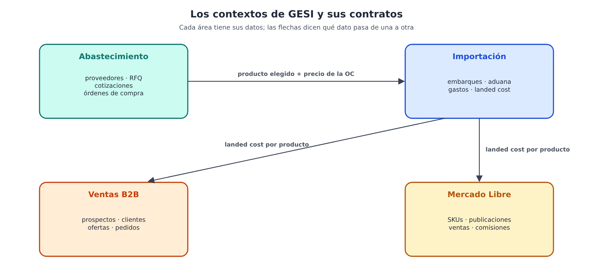
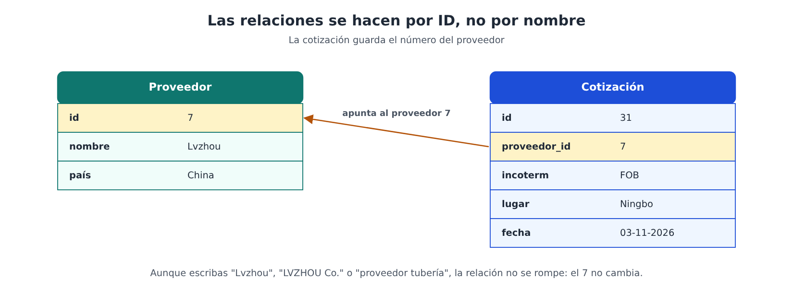
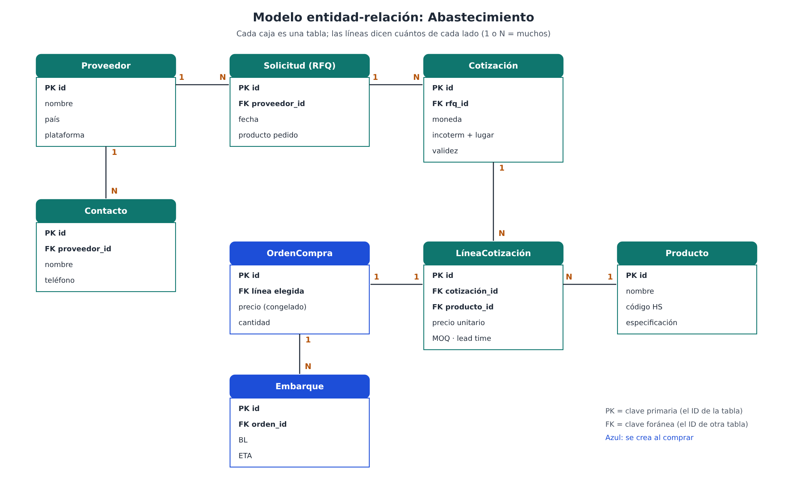
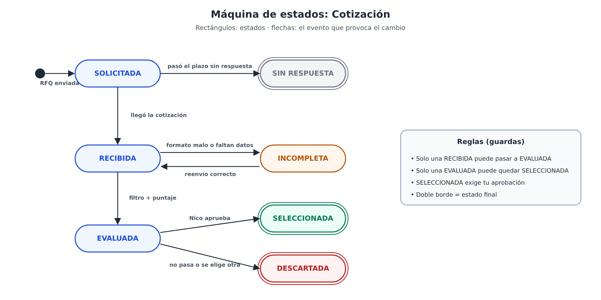
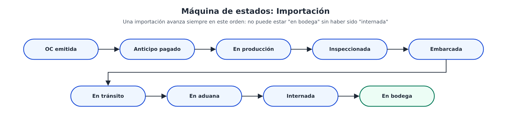

# Lección 2 — Del mapa al modelo

## Por qué esta lección

En la lección 1 dibujamos **cómo fluye** el negocio. Ahora definimos **qué cosas existen**
en él, cómo se llaman, cómo se relacionan y por qué etapas pasan. Esto es el **núcleo** del sistema:
lo que tú tienes que entender, aunque Claude escriba el código.

Al terminar sabrás:

- Qué es Domain-Driven Design (DDD) y sus dos ideas clave: lenguaje común y contextos delimitados.
- La diferencia entre entidades y objetos de valor.
- Cómo hacer un modelo entidad-relación con identificadores y relaciones.
- Qué es una máquina de estados y cómo sale directo del Event Storming.

---

## 1. Domain-Driven Design (DDD)

**DDD** es un enfoque que propuso Eric Evans en 2003. Su idea central:
**el software debe reflejar el negocio tal como lo entienden las personas que lo hacen**.
El "dominio" es tu negocio: importaciones, proveedores, contenedores, clientes.

### 1.1 Lenguaje común (lenguaje ubicuo)

Cada concepto tiene **un solo nombre y una sola definición**, y ese nombre se usa en todas partes:
cuando hablas, en el código, en la base de datos y en las instrucciones del agente.

El problema que resuelve:

| Lo que pasa sin lenguaje común | Consecuencia |
|---|---|
| "Lvzhou", "LVZHOU Co.", "proveedor tubería" | El sistema cree que son tres proveedores |
| "Precio" a veces es FOB y a veces es landed cost | Se comparan peras con manzanas |
| "Cliente" a veces incluye prospectos y a veces no | Los informes no cuadran |

El lenguaje común se escribe en un **glosario**. Ejemplo:

| Término | Definición GESI | No confundir con |
|---|---|---|
| Proveedor | Empresa que fabrica o vende productos que GESI compra | Contacto (la persona con quien hablas) |
| Cotización | Respuesta formal de un proveedor a una RFQ, con precio, incoterm, MOQ y plazo | Precio de lista o conversación informal |
| Landed cost | Costo unitario puesto en bodega GESI, sin IVA | Precio FOB |
| Prospecto | Posible cliente que aún no ha comprado | Cliente |

El glosario es también parte de las instrucciones del agente: si el agente usa el mismo
glosario que tú, se entienden.

### 1.2 Contextos delimitados

Una misma palabra puede significar cosas distintas en distintas áreas del negocio, y eso está bien,
siempre que **cada área tenga límites claros**. Cada área con su propio significado es un
**contexto delimitado** (bounded context).

Ejemplo con "producto":

- En **Abastecimiento**, producto es lo que vende Lvzhou: código del proveedor, especificación, MOQ.
- En **Mercado Libre**, producto es una publicación: título, fotos, precio de venta, SKU.
- En **Importación**, producto es carga: peso, volumen, código arancelario.

Es el mismo tubo, pero cada contexto necesita datos distintos. El error de tu primera app,
probablemente, fue meter todo en un mismo lugar sin límites, o separar sin definir cómo se conectan.

Los contextos de GESI podrían ser:

Las flechas son los **contratos**: qué dato pasa de un contexto a otro.
Por ejemplo, Importación le entrega a Ventas el landed cost de cada producto.
Cuando el contrato está escrito, las piezas conversan.

### 1.3 Entidades y objetos de valor

- **Entidad:** algo que tiene **identidad propia** y la mantiene aunque cambien sus datos.
  Lvzhou sigue siendo Lvzhou aunque cambie de correo o de dirección.
  Se identifica con un **ID único**. Ejemplos: Proveedor, Cotización, Cliente, Embarque.
- **Objeto de valor:** algo definido **solo por sus datos**, sin identidad.
  "US$ 18,50" es igual a cualquier otro "US$ 18,50". Ejemplos: Dinero (monto + moneda),
  Condición de entrega (incoterm + lugar), Dimensiones (largo × ancho × alto).

Por qué importa: los objetos de valor evitan errores. Si "Dinero" siempre lleva su moneda,
es imposible sumar por accidente dólares con liras turcas.

---

## 2. Modelo entidad-relación

El **modelo entidad-relación (ER)** es la forma estándar de pasar el dominio a una base de datos.
Tiene tres piezas:

1. **Entidades:** las "cosas" (se convertirán en tablas).
2. **Atributos:** los datos de cada cosa (se convertirán en columnas).
3. **Relaciones:** cómo se conectan las cosas.

### 2.1 Identificadores

Cada entidad tiene una **clave primaria**: un ID único que no cambia nunca.
Las demás entidades se refieren a ella con ese ID, que en ellas se llama **clave foránea**.

La cotización no guarda el nombre "Lvzhou": guarda el **número 7**.
Así no importa cómo se escriba el nombre: la relación no se rompe.
**Esta es probablemente la pieza que más faltó en tu primera app.**

### 2.2 Tipos de relación (cardinalidad)

| Tipo | Significa | Ejemplo GESI |
|---|---|---|
| 1 a N (uno a muchos) | Uno tiene muchos | Un proveedor tiene muchas cotizaciones |
| N a 1 | Muchos apuntan a uno | Muchas cotizaciones son de un proveedor |
| N a M (muchos a muchos) | Muchos con muchos, mediante una tabla intermedia | Un proveedor ofrece muchos productos y un producto lo ofrecen muchos proveedores: la tabla intermedia es la línea de cotización |

### 2.3 Un primer modelo de Abastecimiento

Ejemplos de atributos:

- **Proveedor:** id, nombre legal, país, plataforma (Alibaba, 1688, directo), estado.
- **Cotización:** id, rfq_id, proveedor_id, fecha, moneda, incoterm, lugar, validez, cumple_formato.
- **LíneaCotización:** id, cotización_id, producto_id, precio_unitario, MOQ, lead_time_días.

### 2.4 Normalización: cada dato en un solo lugar

La regla práctica de la **normalización** es: **cada dato vive en un solo lugar**.

- ❌ El país del proveedor escrito en cada cotización: si te equivocas en una, quedan inconsistentes.
- ✅ El país vive en Proveedor y la cotización apunta al proveedor.

Hay excepciones razonables. El precio de una cotización **sí** se copia a la OC, porque la OC
es un compromiso que no debe cambiar aunque después llegue otra cotización.
La regla es: **se copia lo que debe quedar congelado en el tiempo**.

---

## 3. Máquinas de estado

Cada entidad importante pasa por **etapas**. Una **máquina de estados** define:

- **Estados:** las etapas posibles.
- **Transiciones:** de qué estado se puede pasar a cuál.
- **Eventos:** lo que provoca cada transición (¡los mismos eventos del Event Storming!).
- **Guardas:** condiciones que deben cumplirse. Por ejemplo: "solo se puede seleccionar
  una cotización que esté evaluada".

### Ejemplo: Cotización

### Ejemplo: Importación (resumido)

### Para qué sirven

1. **Evitan estados imposibles:** una importación no puede estar "en bodega" sin haber pasado por "internada".
2. **Hacen visible el trabajo pendiente:** "¿qué cotizaciones están en SOLICITADA hace más de 5 días?"
   es justo el control de "quién respondió y quién no" que pediste para el agente de proveedores.
3. **Le dan reglas claras al agente:** el agente solo puede mover un estado por una transición permitida.

---

## 4. Cómo se conecta todo

| Lección 1 (Event Storming) | Lección 2 (modelo) | Agente |
|---|---|---|
| Evento "Cotización recibida" | Transición SOLICITADA → RECIBIDA | Herramienta `registrar_cotizacion` |
| Política "cuando llega, aplicar filtro" | Guarda: solo RECIBIDA puede pasar a EVALUADA | Regla en las instrucciones del agente |
| Punto caliente "paso datos a mano" | Entidad LíneaCotización bien definida | Herramienta `leer_documento` |
| Actor "Nico aprueba" | Estado SELECCIONADA requiere aprobación | Control humano (lección 18) |

---

## Resumen

- **DDD**: el software refleja el negocio. **Lenguaje común** en un glosario y **contextos delimitados**
  con contratos claros entre ellos.
- **Entidades** con ID único; **objetos de valor** como Dinero (monto + moneda) y Condición de entrega (incoterm + lugar).
- **Modelo ER**: las relaciones se hacen por **ID**, no por nombre. Cada dato en un solo lugar,
  salvo lo que debe quedar congelado (como el precio de una OC).
- **Máquinas de estado**: estados, transiciones, eventos y guardas. Los eventos salen del Event Storming.
